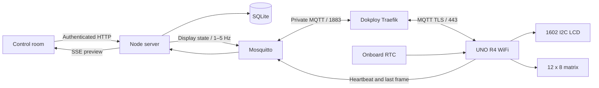

# Architecture and protocol

## Decision

Use **MQTT 3.1.1 over TLS** between the UNO and Mosquitto; use same-origin HTTP + server-sent events between the browser and Node. Node owns timezones, Jalali conversion, message windows and bitmap animation. SQLite stores durable intent. The device owns display timing, matrix playback, the Snake simulation and its offline clock.



The UNO R4 has a Renesas RA4M1 (48 MHz, 32 KB SRAM), a Wi-Fi coprocessor, an RTC and a built-in matrix. It can handle cooperative tasks; lack of application threads does not require every pixel to be streamed. A typical embedded alternative would send settings once and render animations locally. Here the requested server-centric approach makes firmware simpler and keeps calendar/font/message logic editable without flashing it.

Clock/counter ticks run locally on a monotonic timeline. All matrix effects, scrolling text and custom frames play as complete sequences on the matrix hardware timer. Firmware 1.5.0 advertises local-scroll and Snake capabilities. Its unchanged display intent is refreshed every ten seconds, while message transitions and settings updates publish immediately. It scrolls LCD messages locally at one character per 200 ms. Firmware 1.4.0 receives one-second refreshes and uses 300 ms steps; older firmware still receives scrolling positions at up to 5 frames/s. Settings changes and device hello force an immediate update. The heartbeat uses three intact, centered heart sizes with a strong pulse, a softer pulse and a longer rest (56–110 BPM). The matrix hardware timer advances its persistent six-frame sequence independently of blocking network calls.

### Why MQTT

- One outbound connection from the device; no inbound router ports or polling TLS handshakes on the Arduino.
- Small payloads, topic ACLs and heartbeat/last-will support.
- QoS 0 frames are intentionally disposable: the next complete state repairs a dropped frame on the next state refresh while connected. Never retransmit a long backlog of stale animation.
- Commands become durable server settings or scheduled messages, not retained imperative commands.

HTTPS polling is easy to deploy but repeated handshakes and response latency are less suitable for streamed animations. WebSockets could work, but MQTT gives this small device a standard client, broker ACLs and liveness semantics. Native MQTT TLS shares Dokploy’s existing port 443 using a dedicated hostname and Traefik TCP/SNI routing. Dokploy’s existing ACME resolver automatically issues and renews that hostname’s certificate; the broker does not load certificate files.

## Display stream v1

The configured device ID defaults to `uno-r4`. It is limited to 1–32 Latin letters, digits, `_` or `-`.

| Topic | Publisher | Subscriber | QoS / retention |
| --- | --- | --- | --- |
| `mystery-box/<id>/frame` | server | device | 0, never retained |
| `mystery-box/<id>/hello` | device | server | 0, never retained |
| `mystery-box/<id>/status` | device | server | live telemetry 0, never retained; offline last will 1, retained |

The broker has two independent usernames with explicit ACLs. Device credentials cannot publish display frames or read another topic. No anonymous clients. MQTT authentication is separate from dashboard authentication.

Example frame (the epoch/date key below are illustrative):

```json
{
  "v": 1,
  "seq": 42,
  "epoch": 1760000000,
  "offset": 12600,
  "line1": "    14:32:05    ",
  "line2": "  1404/07/25 J  ",
  "backlight": true,
  "matrix": "0003187bc7fc3f81f00e0040",
  "clock": true,
  "hour12": false,
  "seconds": true,
  "dateKey": 20377
}
```

Both LCD rows are exactly 16 printable ASCII bytes; short content is centered. Firmware rejects oversized/invalid rows and matrix payloads. Actual serialized frames are comfortably below the 1280-byte firmware payload limit and 1536-byte MQTT packet buffer. `epoch` is UTC seconds and `ms` is its fractional millisecond (0–999); `clockTop` keeps a local clock above a message, and `heart`/`heartSpeed` enable local pulses. `offset` is the selected timezone’s UTC offset **at that instant**, computed using ICU/IANA rules. No dependency on the Docker host’s timezone. `dateKey = floor((epoch + offset) / 86400)` identifies the local calendar day for offline date freshness.

The matrix is **24 hex characters = 96 bits**, in row-major order (8 rows × 12 columns). The most significant bit of each nibble is the first pixel. `800000000000000000000001` lights the top-left and bottom-right pixels. The device expands this into `uint8_t[8][12]` and calls `matrix.renderBitmap` so it does not depend on internal LED wiring order.

`seq` is a process-local uint32 counter; it resets when the server restarts and wraps naturally. Firmware accepts current frames in TCP order without rejecting a restart’s lower sequence number. Telemetry reports the last sequence received; it is not a durable command acknowledgment or proof that a user saw the screen.

Device status example:

```json
{"online":true,"rssi":-52,"ip":"192.168.1.42","firmware":"1.0.0","seq":42}
```

A fresh telemetry message is required for online status. A retained `online:true` is ignored so an old retained status cannot revive an offline board. Device heartbeats run every 15 seconds; the server marks a device stale at 45 seconds. A retained offline last will gives a faster disconnect signal. Hello prompts an immediate frame; the regular stream also repairs subscription/reconnect races.

## Scheduling and offline behavior

Firmware uses `millis()`-based deadlines, with no `delay()` or blocking retry loops. WiFiS3 connect operations and TLS handshakes are synchronous library calls and **can briefly block**; timeout/backoff reduce disruption but cannot provide hard realtime guarantees. The RTC and hardware LED refresh run independently of the application’s busy loop. Retries back off from 1 to 30 seconds. If a network stack blocks, the previously rendered display remains visible.

The first frame anchors a monotonic clock. Samples every 60 seconds correct drift by at most 2%, without stepping time backwards or replaying buffered seconds. Clock and love-counter rows are drawn locally online and offline; incoming frames select the mode and update calendar metadata. The browser preview uses the same paced clock. After three seconds without a valid frame, the local fallback clock (or love timer when enabled) replaces messages, preserves the backlight and continues the selected matrix sequence. A message is abandoned on loss of stream so it cannot stay on screen indefinitely. The last clock date is shown with `*` while still on the same local day. After midnight without the server, it says **Date needs sync**; it does not pretend to compute a new Jalali date. UTC offset/DST rules are cached until reconnection, so a DST transition during an outage cannot be corrected locally.

The onboard RTC runs while powered. No backup battery is included in the user’s hardware list: after a full power loss the device waits for a new server synchronization. RTC accuracy depends on the board oscillator; this is a desk clock, not a precision time instrument. Initial network delay is not compensated; precision is limited by that delay and the board oscillator. Synchronous Wi-Fi/TLS operations can still delay an application redraw during reconnection.

Messages are scheduled in FIFO windows, each 5–300 seconds (default 120 seconds, configurable in `messaging.defaultDuration`). `messaging.mode` selects `full` (two rows, or header plus scrolling text) or `clock` (live clock above a centered/scrolling message). Windows are wall-clock server times persisted in SQLite. Offline devices miss elapsed windows. Cancelling ends an active message on the next frame but does not reflow later windows. There is no “guaranteed delivery” queue; this avoids showing yesterday’s message after reconnecting.

The UI calls its live hardware visualization a **server preview**. A disconnected physical board is never shown as online solely because the preview is animating.

## HTTP API

All `/api` endpoints except session lookup/login require a 30-day, HTTP-only session cookie tied to an enabled user. Separate equal-owner accounts use persistent scrypt password hashes and hashed SQLite sessions. SameSite=Strict, production Secure cookies, origin validation, input schemas, request size limits and login rate limits are included. Bootstrap passwords and MQTT credentials come from environment variables; account passwords are stored as scrypt hashes. Neither hashes nor MQTT credentials are returned to the browser. Multiple trusted owners, one physical device. Sessions survive server restarts and are revoked by password changes, account disabling, logout or expiry. Bootstrap environment credentials are used only when no users exist.

| Endpoint | Purpose |
| --- | --- |
| `GET /healthz` | HTTP liveness, deliberately independent of device availability |
| `GET /api/session` | Determine whether browser is authenticated |
| `POST /api/login` | `{ "username": "husband", "password": "..." }` |
| `POST /api/logout` | Invalidate current session |
| `GET /api/users`, `POST /api/users`, `PATCH /api/users/:id` | Equal-owner account management, no credential hashes returned |
| `GET /api/messages`, `POST /api/messages/:id/replay` | Searchable paginated archive / resend |
| `GET /api/activity` | Paginated persistent activity journal |
| `GET /api/state` | Snapshot with settings, frame, device status, message history |
| `GET /api/events` | SSE snapshots at 5 Hz; max 20 live clients |
| `PUT /api/settings` | Replace validated settings atomically; required `If-Match` revision header; 409 for stale saves |
| `POST /api/messages` | `{ "text": "Hello", "duration": 120 }`; append a window; omitted duration uses the saved default |
| `POST /api/factory-reset` | Authenticated `{ "password": "…", "confirmation": "RESET", "eraseHistory": false }`; restore defaults and cancel windows, optionally erase notes/journal; preserve accounts and credentials |
| `DELETE /api/messages/:id` | Cancel an active or queued window |

## Research references

Read against official documentation/source during implementation:

- [UNO R4 WiFi hardware and specifications](https://docs.arduino.cc/hardware/uno-r4-wifi)
- [UNO R4 WiFi datasheet and separate Qwiic bus](https://github.com/arduino/docs-content/blob/main/content/hardware/uno/boards/uno-r4-wifi/datasheet/datasheet.md)
- [Renesas RTC API: RTCTime, getTime and setTime](https://github.com/arduino/ArduinoCore-renesas/blob/main/libraries/RTC/src/RTC.h)
- [WiFiS3 TLS client and CA certificate support](https://github.com/arduino/ArduinoCore-renesas/blob/main/libraries/WiFiS3/src/WiFiSSLClient.h)
- [Arduino matrix API and renderBitmap](https://github.com/arduino/ArduinoCore-renesas/blob/main/libraries/Arduino_LED_Matrix/src/Arduino_LED_Matrix.h)
- [PubSubClient buffer sizing, keepalive and timeout](https://pubsubclient.knolleary.net/api.html)
- [HD44780 datasheet: limited eight 5×8 custom characters](https://www.waveshare.com/datasheet/LCD_en_PDF/HD44780.pdf)
- [Mosquitto broker authentication, ACL and TLS settings](https://mosquitto.org/man/mosquitto-conf-5.html)
- [Dokploy domains for Compose services](https://docs.dokploy.com/docs/core/domains)


## Love mode and PWA

Settings include `displayMode` (`clock`, `love`, `alternate`, `scheduled`) and `love` (`startAt`, `timezone`, `title`, `names`, `format`). The UTC instant never changes when the clock timezone changes. Elapsed days are 24-hour durations, with the remaining hours/minutes/seconds. Messages override both clock and love modes for their window. `alternate` uses 12-second phases.

Frames additionally include `love` (currently showing the counter), `loveSince` (UTC seconds), `loveTitle` (ASCII dedication), `loveEnabled` (whether offline fallback should count love), and `loveFormat` (0 days/time, 1 seconds, 2 days, 3 weeks, 4 hours, 5 rotating, 6 calendar years/months/days). Firmware 1.1.0 uses the RTC to maintain elapsed time while disconnected. Older firmware ignores those fields and retains its previous offline clock behavior. The protocol version remains 1 because the added fields are backward compatible. A reflash is needed for the new offline love behavior.

Message storage no longer prunes at 100 entries. Only the live snapshot is bounded; history and activity have cursor pagination. Authors and actor names are captured at write time, including after subsequent profile changes. Mutations and their activity entries are written in the same SQLite transaction. Login failures and system connection transitions are also logged without secrets. Settings revisions prevent silent overwrites between two owners’ devices.

The PWA service worker precaches a versioned list of static build assets and an offline page. It does not intercept or cache `/api/*`, `/healthz`, or mutations. Navigation attempts the network and shows the offline page on failure. It never queues commands or caches private snapshots. App updates require an explicit UI action before a waiting worker takes control. See [the shared setup and iPhone guide](our-story.md).


### Display scheduling and appearance

`displayMode` accepts `clock`, `love`, `alternate` (12-second intervals), and `scheduled`. Scheduled story windows begin at fixed UTC interval boundaries: `(epochSeconds % (schedule.everyMinutes * 60)) < schedule.durationSeconds`. The validated duration is shorter than the interval. Messages override the selected scene without shifting its schedule. `love.format` chooses days/time, seconds, days, weeks, hours or a 10-second rotating counter. Duration counters use exact elapsed seconds. `yearsMonthsDays` uses complete Gregorian months with month-end clamping, followed by complete wall-clock days in `love.timezone`. Frame fields `loveStartWall` and `loveOffset` provide the saved starting wall time and current timezone offset for firmware calendar fallback. Offline timezone offsets remain at their last synchronized values. Existing settings acquire schema defaults on read without discarding saved data. Factory resets atomically increment a persistent `resetRevision` in snapshots; open clients remount their page so old forms, conversations and journal entries do not remain visible after a reset.

Application theme is per-browser (`mb-theme`: `system`, `light`, `dark`). An external, CSP-compatible startup script applies it before the app paints, follows `prefers-color-scheme`, and synchronizes local tabs. The script is included in the versioned static PWA cache. Chat and API data remain uncached. The server keeps all settings shared between the two owners; light/dark preference does not change device backlight.

The rotating story counter cycles every ten seconds through days/time, years/months/days, total seconds, total days, weeks/days and total hours. Calendar counts use the saved story timezone and clamp month-end anniversaries to shorter months.

### Local matrix programs

The retained, QoS 1 `mystery-box/<id>/matrix` topic carries a compact versioned program (`mode`, `speed`, text or custom frames, and a content revision). Only the server can publish it; the device can subscribe. It is published on broker connect, device hello and matrix settings changes. Duplicate revisions never restart playback. Matrix configuration is limited to 1024 bytes. The device expands it into a persistent buffer of up to 512 frames (maximum 510 for 80-character text), then the LED hardware timer loops it independently of network calls. Presets and the font are generated from the shared preview source by `node --import tsx scripts/generate-matrix.ts`; tests verify the generated header and exact native/preview frame parity. Telemetry reports `matrixRevision` to confirm which program the device accepted.


### Local LCD scrolling and diagnostics (firmware 1.4.0)

The optional `scroll` field contains message `id`, printable ASCII `text` (160 characters maximum), `phase` (milliseconds within the text-plus-four-spaces cycle), `stepMs` (200 for 1.5.0, 300 for 1.4.0), and `remaining` (milliseconds before expiry, at most 300000). The device uses `millis()` to advance text; repeated commands for the same message renew its lease without resetting its position. A missing/null command cancels local scrolling. Both short-message layouts remain unchanged. The browser preview continues to render server positions. The server sends scrolling commands after receiving the `lcdScroll` capability or 1.4.0 telemetry; older devices keep the original protocol. Broker payloads allow 1280 bytes; the device MQTT packet buffer remains 1536 bytes.

Startup stages appear on the LCD and USB serial output. A disconnected box shows `(-_-) zZ` with Wi-Fi/broker status, temporarily turning the backlight on. Wi-Fi and MQTT failures retry with exponential backoff capped at 30 seconds. Network connection calls can still block briefly; normal connected scrolling uses no delays and writes only changed LCD spans.

The centralized fault handler tracks E1 LCD initialization/write, E2 RTC initialization/time sync, E3 MQTT allocation, E4 Wi-Fi, E5 broker/subscribe/send setup, E6 no valid frame for thirty seconds in 1.5.0 (five seconds in 1.4.0), E7 invalid display payload, and E8 invalid matrix program. The matrix shows the lowest active code as two stationary 5×7 glyphs (firmware 1.6.1), taking priority over all user modes (including off). A separate static bitmap preserves the user's animation and restores it after recovery. E1–E3 require restart after fixing their cause; connection and protocol errors clear automatically when their operation succeeds. This covers detectable application errors; power loss, a failed LED matrix, and processor lockups cannot report themselves.

Telemetry includes `errors` (active bitmask) and `occurred` (faults raised since the last successful status publish). Bit 0 is E1 through bit 7 for E8. The server journals transitions and the frontend journal includes the complete meaning/remedy guide. Offline errors are reported after reconnecting; this is an in-memory summary, not a persistent per-event device log, and can be lost on reset or failed delivery. Timestamps record server receipt. Multiple occurrences between heartbeats are coalesced. Passwords and raw MQTT payloads are never logged.


### Cooperative timing and Snake (firmware 1.5.0)

WiFiS3 `connected()` performs serial modem transactions. The firmware caches healthy transport results for at most 500 ms, invalidates on stop, polls MQTT at most every 25 ms, and reserves the final 100 ms before an LCD step for local drawing, increasing that budget up to 150 ms if measured network polls require it. Local tasks run before and after network polls. Display updates carry complete message text and an expiry lease, rather than individual positions. The server publishes unchanged intent every ten seconds and immediately on message activation, cancellation, expiry, timezone day/offset changes and settings changes. Matrix revision acknowledgments are reported promptly to stop the legacy streamed fallback. Serial diagnostics report maximum network-poll duration and observed LCD step intervals. A 1602 is a character display: motion remains character-by-character, with no pixel-level interpolation. Temporary network stalls can still delay cooperative drawing.

`SnakeGame` is a fixed-memory, heap-free 12×8 simulation running on the board. Moves occur every 280 ms initially, accelerating to a minimum of 140 ms. It accepts two pending perpendicular turns, rejects reversals, handles a vacating tail correctly, places food only on empty cells, and detects walls, self-collision and a full-board win. Delayed loops advance only once, never in a catch-up burst. Food uses a noncryptographic xorshift generator seeded on the board; no randomness is used for security.

Authenticated same-origin `POST /api/snake` accepts strict start/turn/pause/resume/stop/keepalive commands. Starting grants one user/browser an ephemeral controller token; that token is never included in SSE snapshots. A second controller gets a conflict. Turn inputs are bounded and serialized in the browser, throttled on the server, tagged with monotonically increasing command sequence numbers, and rejected if stale by the device. User-supplied payloads cannot choose arbitrary MQTT topics. The app publishes non-retained QoS 0 commands to `mystery-box/<id>/game`; only the server account can publish there. The device publishes its validated board state to `.../game/state`; only the device can publish there. No offline command backlog is queued. Start is retried with the same game ID until acknowledged and is idempotent on the board. Browser SSE previews use confirmed hardware state instead of running an independent prediction that could disagree with the matrix.

The browser renews its ownership lease every two seconds and pauses on blur/visibility loss. The server sends a one-second board keepalive while a controller is live; ownership expires after eight seconds without browser activity. The board independently pauses after 3.5 seconds without commands, or immediately when disconnected/errored; after eight seconds without commands it ends the game and restores the animation. Keepalive does not silently resume a paused game. Reconnects do not replay old directions. Leaving the game page sends a best-effort stop; server shutdown releases the game. Games are deliberately ephemeral and never overwrite saved matrix settings. Error codes override game output and prevent starting a new game on an errored device.

Phone controls use pointer-down buttons with 56 px targets and no page scrolling on the pad; screen-reader/keyboard activation remains supported. Laptop arrows steer only while playing, excluding editable fields and modifier shortcuts; Space pauses/resumes. Inputs stop while board feedback is stale. The native game tests cover rollover, turn buffering, illegal reversals, walls, pause/resume, growth and a full-board win, and API tests verify authentication, origin checks, validation, controller conflicts and timeout cleanup.


### Message attention and deletion (firmware 1.6.0)

`messaging.blink` is an opt-in setting with a migration/default value of false. Frames carry `messageId` for every active message (including short static messages), `messageAge` in milliseconds, and `notify` from the saved setting. Message identity participates in the server display signature so two successive notes with identical text still produce separate state updates. The board records each new identity once, starts attention only for a fresh message younger than four seconds, ignores duplicate/replayed identities, and cancels an active alert when disabled or when the display message ends. The device uses unsigned `millis()` deltas: six 250 ms on/250 ms off cycles over three seconds, with no delay loops and no LCD clears.

During attention, the LCD backlight and matrix alternate between full-on and off. The persistent matrix program is preserved and restored. Errors and disconnects cancel the alert immediately; error codes have higher priority. The Snake simulation pauses and clears buffered turns before movement during attention, and keepalives cannot resume it. A deliberate Resume is needed once the alert ends. Normal LCD text and its local scroll continue. The device remembers notification identities in RAM; very fresh messages may alert again after a power cycle, while old messages are suppressed by their age.

Authenticated same-origin `POST /api/messages/delete` accepts 1–100 distinct, bounded message IDs (including legacy records). Selection is explicit; no implicit “all messages” flag exists. SQLite deletes the requested rows and increments `historyRevision` in one transaction, along with an audit record containing the count but no message content. Missing IDs are harmless for retries. Deleting active/queued rows removes them from the next rendered state immediately without shifting the surviving scheduled windows. The operation is permanent, and the UI requires an exact-count confirmation for single and bulk actions. The native dialog traps focus, initially focuses Keep, allows Escape before a request starts, and disables controls while a request runs.

`POST /api/messages/lookup` is an authenticated bounded read of up to 100 IDs. When `historyRevision` changes over SSE, open conversations reconcile all loaded pages in batches, removing deleted notes without resetting search, pagination or the current scroll position. In-flight history requests predating deletion are discarded; locally deleted IDs cannot be reinserted by an older snapshot. The three-dot menu uses a single parent-owned open ID, renders in a portal above the conversation scroller, clamps/flips within the viewport, and closes on outside pointer/focus, Escape, scrolling or resizing. Arrow keys and Home/End navigate items; dismissal returns focus to the trigger when appropriate. Selection and deletion remain independent of replay and cancellation.

`POST /api/messages/:id/cancel` stops only LCD display and keeps history. The legacy `DELETE /api/messages/:id` keeps that same cancellation behavior for cached older clients; permanent deletion uses the explicit batch endpoint so an older client’s Cancel action cannot unexpectedly erase a note.


### Reading speed and preference layout (firmware 1.7.0)

`messaging.scrollStepMs` is a persisted integer from 200 to 1000 ms in 50 ms increments, defaulting to 400 ms for new and migrated settings. The renderer uses the same interval for preview windows, `scroll.phase` and `scroll.stepMs`. The board validates the interval and reports `scrollSpeed: true` in telemetry. The server normalizes this capability on every status message and immediately republishes state when it changes. Older local-scroll firmware receives its compatible 200 ms interval (300 ms for 1.4.0), preventing E7 during an app-first upgrade; older streamed displays use the configured server positions. The maximum network quiet budget remains below the minimum scroll period, so slower speeds cannot starve MQTT polling.

The local scroller preserves both the current character and fractional progress when changing its interval. Duplicate commands at an unchanged speed renew only the expiry lease. Native tests cover this behavior and invalid speed rejection; renderer tests verify migration, bounds and preview/device timing agreement. Real MQTT integration checks compatibility negotiation and changing speed during an active message.

Preferences groups a Slower/Faster slider and timed 16-character reading preview separately from the flash alert. The flash control is a labeled button with switch semantics, a 44 px touch target, an explicit On/Off state and a separate description. It avoids wrapping a checkbox inside the form’s generic label/input styles. The live preview is not an ARIA live region, so changing text does not repeatedly interrupt a screen reader.
