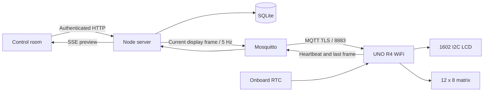

# Architecture and protocol

## Decision

Use **MQTT 3.1.1 over TLS** between the UNO and Mosquitto; use same-origin HTTP + server-sent events between the browser and Node. Node owns timezones, Jalali conversion, message windows and bitmap animation. SQLite stores durable intent. The device owns only transport, display output and a minimal offline clock.



The UNO R4 has a Renesas RA4M1 (48 MHz, 32 KB SRAM), a Wi-Fi coprocessor, an RTC and a built-in matrix. It can handle cooperative tasks; lack of application threads does not require every pixel to be streamed. A typical embedded alternative would send settings once and render animations locally. Here the requested server-centric approach makes firmware simpler and keeps calendar/font/message logic editable without flashing it.

This trades offline animation and bandwidth for central control. The display stream is capped at 5 frames/s, roughly a few KB/s including protocol overhead. It is appropriate for this 96-pixel matrix and character LCD, not a video display.

### Why MQTT

- One outbound connection from the device; no inbound router ports or polling TLS handshakes on the Arduino.
- Small payloads, topic ACLs and heartbeat/last-will support.
- QoS 0 frames are intentionally disposable: the next complete state repairs a dropped frame within ~200ms while connected. Never retransmit a long backlog of stale animation.
- Commands become durable server settings or scheduled messages, not retained imperative commands.

HTTPS polling is easy to deploy but repeated handshakes and response latency are less suitable for streamed animations. WebSockets could work, but MQTT gives this small device a standard client, broker ACLs and liveness semantics. Native TLS requires a second public TCP port/certificate endpoint beside the HTTPS dashboard.

## Display stream v1

The configured device ID defaults to `uno-r4`. It is limited to 1–32 Latin letters, digits, `_` or `-`.

| Topic | Publisher | Subscriber | QoS / retention |
| --- | --- | --- | --- |
| `mystery-box/<id>/frame` | server | device | 0, never retained |
| `mystery-box/<id>/hello` | device | server | 0, never retained |
| `mystery-box/<id>/status` | device | server | live telemetry 0, never retained; offline last will 1, retained |

The broker has two independent usernames with explicit ACLs. Device credentials cannot publish display frames or read another topic. No anonymous clients. MQTT authentication is separate from dashboard authentication.

Example frame (the epoch/date key below are illustrative):

```json
{
  "v": 1,
  "seq": 42,
  "epoch": 1760000000,
  "offset": 12600,
  "line1": "    14:32:05    ",
  "line2": "  1404/07/25 J  ",
  "backlight": true,
  "matrix": "0003187bc7fc3f81f00e0040",
  "clock": true,
  "hour12": false,
  "seconds": true,
  "dateKey": 20377
}
```

Both LCD rows are exactly 16 printable ASCII bytes; short content is centered. Firmware rejects oversized/invalid rows and matrix payloads. Actual serialized frames are comfortably below the 768-byte firmware payload limit and 1024-byte MQTT packet buffer. `epoch` is UTC seconds; `offset` is the selected timezone’s UTC offset **at that instant**, computed using ICU/IANA rules. No dependency on the Docker host’s timezone. `dateKey = floor((epoch + offset) / 86400)` identifies the local calendar day for offline date freshness.

The matrix is **24 hex characters = 96 bits**, in row-major order (8 rows × 12 columns). The most significant bit of each nibble is the first pixel. `800000000000000000000001` lights the top-left and bottom-right pixels. The device expands this into `uint8_t[8][12]` and calls `matrix.renderBitmap` so it does not depend on internal LED wiring order.

`seq` is a process-local uint32 counter; it resets when the server restarts and wraps naturally. Firmware accepts current frames in TCP order without rejecting a restart’s lower sequence number. Telemetry reports the last sequence received; it is not a durable command acknowledgment or proof that a user saw the screen.

Device status example:

```json
{"online":true,"rssi":-52,"ip":"192.168.1.42","firmware":"1.0.0","seq":42}
```

A fresh telemetry message is required for online status. A retained `online:true` is ignored so an old retained status cannot revive an offline board. Device heartbeats run every 15 seconds; the server marks a device stale at 45 seconds. A retained offline last will gives a faster disconnect signal. Hello prompts an immediate frame; the regular stream also repairs subscription/reconnect races.

## Scheduling and offline behavior

Firmware uses `millis()`-based deadlines, with no `delay()` or blocking retry loops. WiFiS3 connect operations and TLS handshakes are synchronous library calls and **can briefly block**; timeout/backoff reduce disruption but cannot provide hard realtime guarantees. The RTC and hardware LED refresh run independently of the application’s busy loop. Retries back off from 1 to 30 seconds. If a network stack blocks, the previously rendered display remains visible.

The RTC is synchronized on the first valid frame and every 60 seconds. Online LCD content is server-rendered. After three seconds without a valid frame, firmware resumes its local RTC clock (or elapsed love timer when enabled), preserves the backlight setting and freezes the matrix on its last frame. A message is abandoned on loss of stream so it cannot stay on screen indefinitely. The last clock date is shown with `*` while still on the same local day. After midnight without the server, it says **Date needs sync**; it does not pretend to compute a new Jalali date. UTC offset/DST rules are cached until reconnection, so a DST transition during an outage cannot be corrected locally.

The onboard RTC runs while powered. No backup battery is included in the user’s hardware list: after a full power loss the device waits for a new server synchronization. RTC accuracy depends on the board oscillator; this is a desk clock, not a precision time instrument. Network delay is not compensated, so online/offline synchronization accuracy is approximately one second plus network latency.

Messages are scheduled in FIFO windows, each 5–300 seconds. Windows are wall-clock server times persisted in SQLite. Offline devices miss elapsed windows. Cancelling ends an active message on the next frame but does not reflow later windows. There is no “guaranteed delivery” queue; this avoids showing yesterday’s message after reconnecting.

The UI calls its live hardware visualization a **server preview**. A disconnected physical board is never shown as online solely because the preview is animating.

## HTTP API

All `/api` endpoints except session lookup/login require a 30-day, HTTP-only session cookie tied to an enabled user. Separate equal-owner accounts use persistent scrypt password hashes and hashed SQLite sessions. SameSite=Strict, production Secure cookies, origin validation, input schemas, request size limits and login rate limits are included. Bootstrap passwords and MQTT credentials come from environment variables; account passwords are stored as scrypt hashes. Neither hashes nor MQTT credentials are returned to the browser. Multiple trusted owners, one physical device. Sessions survive server restarts and are revoked by password changes, account disabling, logout or expiry. Bootstrap environment credentials are used only when no users exist.

| Endpoint | Purpose |
| --- | --- |
| `GET /healthz` | HTTP liveness, deliberately independent of device availability |
| `GET /api/session` | Determine whether browser is authenticated |
| `POST /api/login` | `{ "username": "husband", "password": "..." }` |
| `POST /api/logout` | Invalidate current session |
| `GET /api/users`, `POST /api/users`, `PATCH /api/users/:id` | Equal-owner account management, no credential hashes returned |
| `GET /api/messages`, `POST /api/messages/:id/replay` | Searchable paginated archive / resend |
| `GET /api/activity` | Paginated persistent activity journal |
| `GET /api/state` | Snapshot with settings, frame, device status, message history |
| `GET /api/events` | SSE snapshots at 5 Hz; max 20 live clients |
| `PUT /api/settings` | Replace validated settings atomically; required `If-Match` revision header; 409 for stale saves |
| `POST /api/messages` | `{ "text": "Hello", "duration": 15 }`; append a window |
| `DELETE /api/messages/:id` | Cancel an active or queued window |

## Research references

Read against official documentation/source during implementation:

- [UNO R4 WiFi hardware and specifications](https://docs.arduino.cc/hardware/uno-r4-wifi)
- [UNO R4 WiFi datasheet and separate Qwiic bus](https://github.com/arduino/docs-content/blob/main/content/hardware/uno/boards/uno-r4-wifi/datasheet/datasheet.md)
- [Renesas RTC API: RTCTime, getTime and setTime](https://github.com/arduino/ArduinoCore-renesas/blob/main/libraries/RTC/src/RTC.h)
- [WiFiS3 TLS client and CA certificate support](https://github.com/arduino/ArduinoCore-renesas/blob/main/libraries/WiFiS3/src/WiFiSSLClient.h)
- [Arduino matrix API and renderBitmap](https://github.com/arduino/ArduinoCore-renesas/blob/main/libraries/Arduino_LED_Matrix/src/Arduino_LED_Matrix.h)
- [PubSubClient buffer sizing, keepalive and timeout](https://pubsubclient.knolleary.net/api.html)
- [HD44780 datasheet: limited eight 5×8 custom characters](https://www.waveshare.com/datasheet/LCD_en_PDF/HD44780.pdf)
- [Mosquitto broker authentication, ACL and TLS settings](https://mosquitto.org/man/mosquitto-conf-5.html)
- [Dokploy domains for Compose services](https://docs.dokploy.com/docs/core/domains)


## Love mode and PWA

Settings now include `displayMode` (`clock`, `love`, `alternate`) and `love` (`startAt`, `timezone`, `title`, `names`). The UTC instant never changes when the clock timezone changes. Elapsed days are 24-hour durations, with the remaining hours/minutes/seconds. Messages override both clock and love modes for their window. `alternate` uses 12-second phases.

Frames additionally include `love` (currently showing the counter), `loveSince` (UTC seconds), `loveTitle` (ASCII dedication), and `loveEnabled` (whether offline fallback should count love). Firmware 1.1.0 uses the RTC to maintain elapsed time while disconnected. Older firmware ignores those fields and retains its previous offline clock behavior. The protocol version remains 1 because the added fields are backward compatible. A reflash is needed for the new offline love behavior.

Message storage no longer prunes at 100 entries. Only the live snapshot is bounded; history and activity have cursor pagination. Authors and actor names are captured at write time, including after subsequent profile changes. Mutations and their activity entries are written in the same SQLite transaction. Login failures and system connection transitions are also logged without secrets. Settings revisions prevent silent overwrites between two owners’ devices.

The PWA service worker precaches a versioned list of static build assets and an offline page. It does not intercept or cache `/api/*`, `/healthz`, or mutations. Navigation attempts the network and shows the offline page on failure. It never queues commands or caches private snapshots. App updates require an explicit UI action before a waiting worker takes control. See [the shared setup and iPhone guide](our-story.md).
